Hi, I'm Rashi, a final-year B.Tech Computer Science student at JECRC University, Jaipur.

I like turning ideas into small, useful things. Sometimes that means building a little web app, and sometimes it means organising people and getting a plan over the line. I've built a few projects to learn by doing, and spent ten months at my university's Training & Placement Office coordinating campus drives.

🌸 Open to internships and entry-level roles &nbsp;·&nbsp; 📍 Jaipur, India

<table>
<tr>
<td width="50%" valign="top">
📄 <b><a href="https://github.com/Rashi18032006/DocuMind">DocuMind</a></b> 
Upload PDFs or Word files and ask questions about them. Each answer points to the page it came from.  
🌱 Explored: Python · FastAPI · Supabase · Next.js · OpenAI
</td>
<td width="50%" valign="top">
📝 <b><a href="https://github.com/Rashi18032006/Exam_Paper-generator">Exam Paper Generator</a></b> · <a href="https://exam-paper-generator-eight.vercel.app">live</a> 
Creates an exam paper from a topic and difficulty level, with a review step where a teacher can approve it or ask for changes.  
🌱 Explored: Next.js · TypeScript · Gemini
</td>
</tr>
<tr>
<td width="50%" valign="top">
🎬 <b><a href="https://github.com/Rashi18032006/FastFlicker">FastFlicker</a></b> 
Turns an educational YouTube video into study notes and flashcards.  
🌱 Explored: Python · Streamlit · Groq
</td>
<td width="50%" valign="top">
💬 <b><a href="https://github.com/Rashi18032006/UpGrad-Project-submissions">Q&amp;A Backend</a></b> 
A Quora-style backend for questions, answers and user accounts, built for an upGrad course.  
🌱 Explored: Java · Spring Boot
</td>
</tr>
</table>

🌻 **Intern, Training & Placement Office**, JECRC University · Mar 2025 – Jan 2026 
Coordinated campus placement drives end to end and kept the recruiter database organised.

🌻 **HR Intern, Training & Development**, Fortis Escorts Hospital, Jaipur · Jun 2024 
Supported training workshops, recruitment and onboarding.

🌻 **Generation Green Awareness Intern**, AICTE × Oppo India × 1M1B · Aug – Oct 2024 
Planned and ran an e-waste awareness drive across schools in Jaipur.

I've used these a little while building the projects above. I'm still learning all of them.

**Languages** &nbsp; `Python` `JavaScript` `TypeScript` `Java` `SQL` `HTML` `CSS` 
**Web** &nbsp; `React` `Next.js` `Streamlit` `FastAPI` `Spring Boot` 
**Data** &nbsp; `PostgreSQL` `Supabase` `MySQL` 
**AI tools** &nbsp; `OpenAI` `Gemini` `Groq` 
**Everyday** &nbsp; `Git` `GitHub` `Vercel`

🌱 Getting more confident with Python and the basics of building for the web 
📜 Certificates: Frontend Development · Blockchain and its Applications · Algorithm Analysis & Design Thinking (upGrad) · Google Cloud Computing Foundations

💌 [khandelwalrashi38@gmail.com](mailto:khandelwalrashi38@gmail.com)

